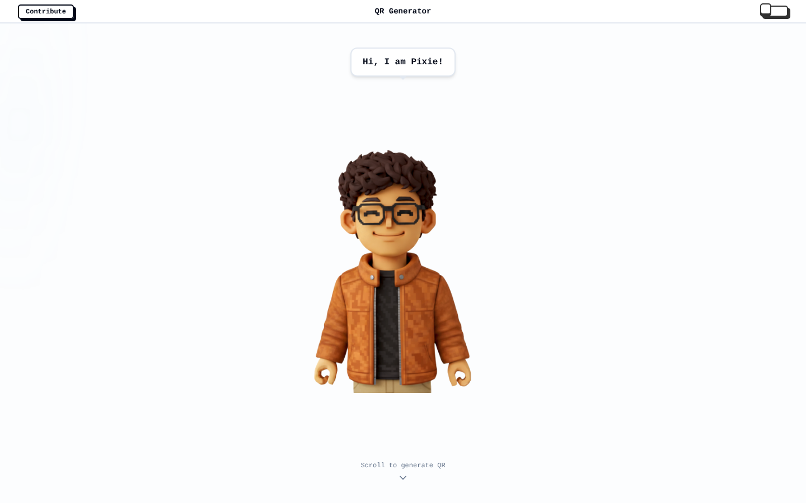
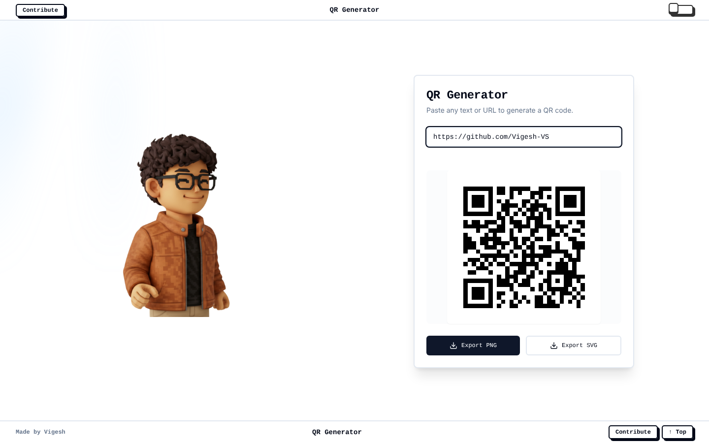
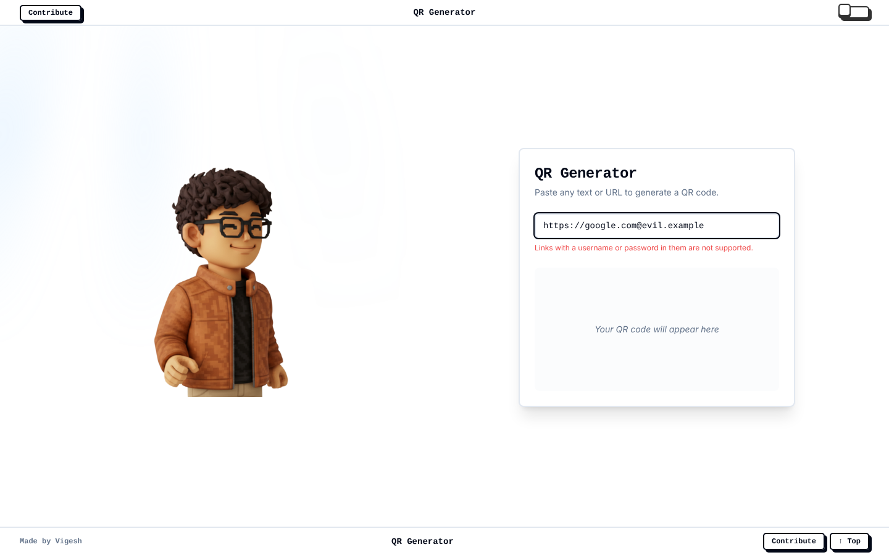
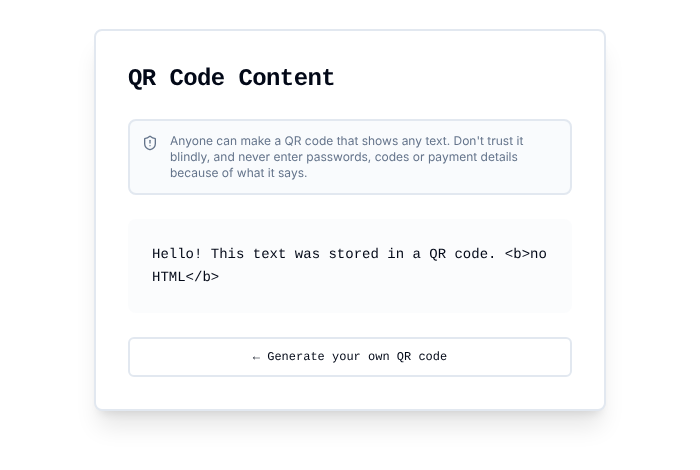
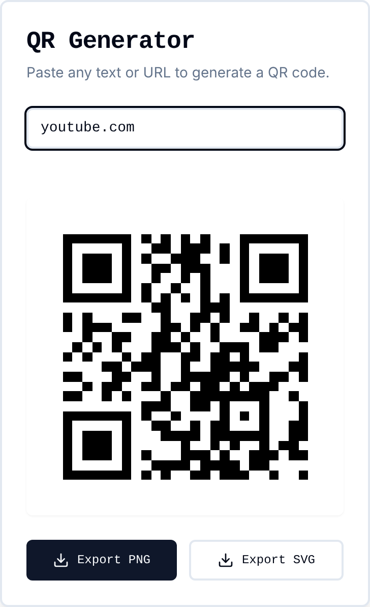
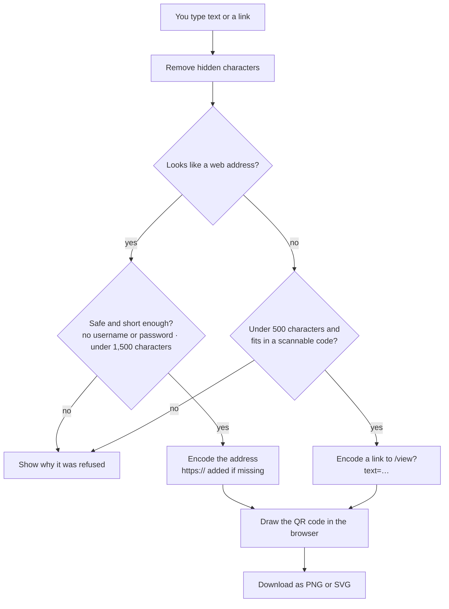

# 🔳 QR Generator

Turn any link or text into a QR code and download it as a sharp PNG or a scalable SVG. Everything runs in your browser: nothing you type is ever sent anywhere.

Open source under the MIT License · [Contributions welcome](CONTRIBUTING.md)

[](https://github.com/Vigesh-VS/qr-generator/actions/workflows/ci.yml)
[](LICENSE)
[](CONTRIBUTING.md)




## Screenshots

| Generator | Safety check |
|---|---|
|  |  |

| Scanned text page | On a phone |
|---|---|
|  |  |

## Features

- **Instant QR codes** for any link or text, drawn as you type.
- **Links stay links.** Type `youtube.com` or a full `https://…` address and the code opens that site. `https://` is added when it is missing.
- **Text works too.** Anything that is not a web address becomes a code that opens a small page on this site showing your text, so scanners display it instead of trying to open it.
- **PNG and SVG download.** The PNG is exported at 1024 px, sharp enough to print. The SVG scales to any size.
- **Dark and light mode** and a layout that works on desktop and phone.
- **Contribute page** with a UPI QR code for optional donations.

## How it works



A code that holds plain text opens the `/view` page, which shows the text as plain text only, with a reminder that anyone can make a QR code that says anything.

## Tech stack

| Part | Technology |
|---|---|
| Frontend | React 18, TypeScript (strict), Vite, Tailwind CSS, shadcn/ui (Radix) |
| QR codes | [`qrcode`](https://www.npmjs.com/package/qrcode), drawn in the browser |
| Routing | React Router 6 |
| Tests | Vitest, Testing Library |
| Hosting | Any static host. `vercel.json` includes the routing rules and security headers |

There is no backend, no database, no account system and no analytics.

## Getting started

Requires Node.js 20+.

```bash
git clone https://github.com/Vigesh-VS/qr-generator.git
cd qr-generator
npm install
npm run dev
```

Open <http://localhost:8080>. There are no environment variables to set.

## Deploy

1. Import this repository in [Vercel](https://vercel.com) (the Vite framework is detected automatically), or run `npm run build` and upload the `dist/` folder to any static host.
2. Make sure every path falls back to `index.html`, so `/view` and `/contribute` work when opened directly. `vercel.json` already does this.
3. Optional: set the repository's **Website** field on GitHub to your live address.

## Security and privacy

**Privacy**
- Nothing you type leaves your browser. There is no server to send it to, and no analytics or trackers.
- The only thing stored anywhere is the light or dark mode choice, in your browser.

**Guardrails on what goes into a code** (`src/lib/qr.ts`)
- Text is limited to 500 characters and links to 1,500, and the final size is capped so codes stay easy to scan. Anything over the limit is refused with a clear message instead of failing silently.
- Links with a username or password in them (like `https://google.com@evil.example`) are refused. This is a common phishing trick.
- Control characters and invisible text-direction characters are removed from input.
- Things that only look like web addresses, such as `notes.pdf`, are treated as text, and script-style input like `javascript:alert(1)` is only ever encoded as plain text.

**Guardrails on the view page** (`/view`)
- The text is shown as plain text only. It is never rendered as HTML and never turned into a clickable link.
- The page shows a warning that anyone can make a QR code that says anything, and tells readers never to enter passwords or payment details because of it.
- Very long text is cut off, and the page is marked `noindex` so search engines skip it.

**Website protections** (`vercel.json`): a strict Content-Security-Policy (only this site's own files, no third-party scripts, no framing), `X-Content-Type-Options`, `X-Frame-Options`, `Referrer-Policy`, `Permissions-Policy` and HSTS. The `/view` page also gets `X-Robots-Tag: noindex`.

**Supply chain**: CI runs lint, type checks, tests and a build on every change, and Dependabot opens weekly update pull requests.

**What a QR code can't protect against**: a code can point to any site its creator chooses. Always check the address your phone shows before opening it. See [SECURITY.md](SECURITY.md) to report a problem privately.

## Scripts

| Command | What it does |
|---|---|
| `npm run dev` | Dev server at http://localhost:8080 |
| `npm run build` | Production build into `dist/` |
| `npm run preview` | Serve the production build locally |
| `npm test` | Unit and component tests |
| `npm run typecheck` | TypeScript check (strict mode) |
| `npm run lint` | ESLint |

## Project structure

```
src/
  lib/qr.ts                 what goes into a code, and what gets refused
  lib/qr.test.ts            tests for those rules
  components/QRGenerator.tsx  the generator card, PNG and SVG export
  components/               top and bottom bars, dark mode toggle
  components/ui/            shadcn/ui building blocks
  pages/Index.tsx           landing page and generator
  pages/ViewText.tsx        shows text from a scanned code
  pages/Contribute.tsx      UPI donation page
.github/                    CI, Dependabot, issue and pull request templates
vercel.json                 routing and security headers
```

## Troubleshooting

- **"Links with a username or password…" message:** remove the part before the `@` in the address.
- **"Too long" message:** shorten the text. Shorter content makes a simpler code that scans faster.
- **A file name like `notes.pdf` became a text code, not a link:** that is intended. Add `https://` in front if you really mean a website.
- **Opening `/view` or `/contribute` directly shows a 404 on your host:** configure the host to send every path to `index.html`.
- **The downloaded PNG looks soft when printed large:** use the SVG, which stays sharp at any size.

## Contributing

Contributions are welcome, from bug reports and ideas to docs and code. Read the [contributing guide](CONTRIBUTING.md) to get set up, then pick an issue labelled [`good first issue`](https://github.com/Vigesh-VS/qr-generator/issues?q=is%3Aissue+is%3Aopen+label%3A%22good+first+issue%22) or open your own. Please follow the [Code of Conduct](CODE_OF_CONDUCT.md), and report security problems privately as described in [SECURITY.md](SECURITY.md).

## License

[MIT](LICENSE) © 2026 Vigesh V S. You're free to use, modify and share this code, including commercially, as long as the copyright notice is kept.

## Author

**Vigesh** · [GitHub @Vigesh-VS](https://github.com/Vigesh-VS)
